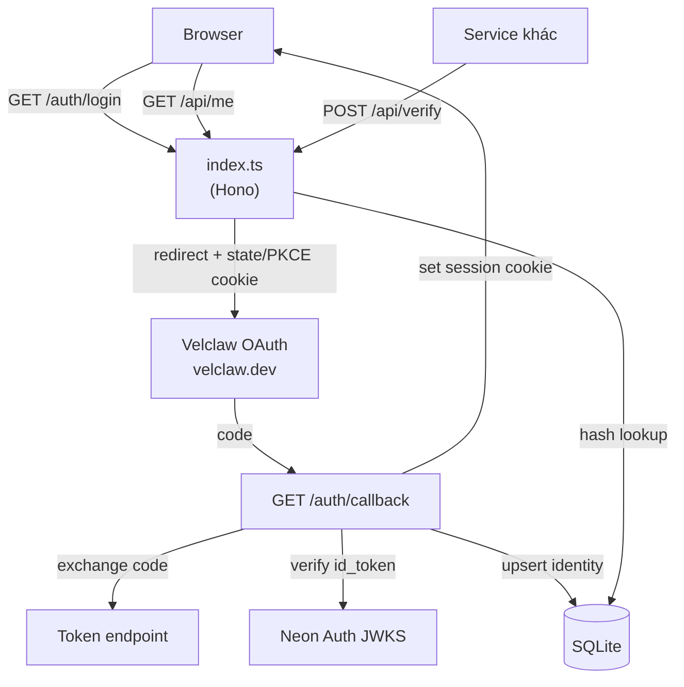

# Velclaw Identity

Lớp xác thực (identity/auth) cho **Velclaw**, chạy trên Val Town.

Dự án Velclaw tách phần auth ra khỏi workspace: `Velclaw/VELCLAW` giữ product
UI, còn `Velclaw/Oauth` lo OAuth entry point và session. Val này đóng vai trò
cầu nối: verify JWT do **Neon Auth** phát hành (theo `Authentication/JWKS`
trong repo VELCLAW), duy trì session máy chủ, và làm OAuth callback.

> Lưu ý từ README của VELCLAW: OAuth service **chưa được verify** về hostname và
> routing. Mọi URL trong val này đều override được bằng env var.

- **App:** [ocodejs/velclaw-identity](url:index.ts)
- **Sức khỏe hệ thống:** [GET /api/health](url:index.ts/api/health)
- **JWKS mirror:** [GET /.well-known/jwks.json](url:index.ts/.well-known/jwks.json)

## Kiến trúc



## Endpoints

| Method | Path | Mô tả |
| --- | --- | --- |
| GET | `/` | Trang chủ + trạng thái phiên |
| GET | `/auth/login` | Bắt đầu OAuth (state + PKCE S256) |
| GET | `/auth/callback` | Nhận `code`, đổi token, tạo session |
| POST | `/auth/logout` | Revoke session hiện tại |
| GET | `/api/me` | Identity của phiên hiện tại (401 nếu chưa đăng nhập) |
| POST | `/api/verify` | Verify JWT bất kỳ với JWKS của Velclaw |
| POST | `/api/token` | Cấp access token ngắn hạn cho user đã đăng nhập |
| GET | `/.well-known/jwks.json` | Mirror JWKS upstream (cache 10 phút) |
| GET | `/api/health` | Kiểm tra JWKS + cấu hình OAuth |
| GET | `/docs` | Tài liệu API cho người đọc |
| GET | `/api/openapi.json` | OpenAPI 3.1 spec |
| GET | `/api/skills.json` | Danh mục skills, lọc `?category=` `?q=` |

## Tài liệu & khám phá

Ba cách tiếp cận cùng một API, tuỳ đối tượng:

| Đối tượng | Dùng |
| --- | --- |
| Người đọc | [GET /docs](url:index.ts/docs) |
| Công cụ (Postman, Insomnia, Swagger UI) | [GET /api/openapi.json](url:index.ts/api/openapi.json) |
| Agent / script | `GET /api/skills.json` |

**OpenAPI** được sinh từ `backend/openapi.ts` và nhận `servers[0].url` từ
request thực tế, nên import vào Postman là gọi được ngay — không cần sửa tay.

**Skills catalog** nằm tĩnh trong `backend/skills.ts` (17 skill, 4 nhóm), chép
theo `docs/AGENT-SKILLS-DIRECTORY.md` của repo `docs-ocodejs`. Vì là dữ liệu
tĩnh nên endpoint không phụ thuộc mạng ngoài và không bị rate limit.

```bash
curl '$BASE/api/skills.json?category=frontend'
curl '$BASE/api/skills.json?q=test'
```

Category không hợp lệ trả `400` kèm danh sách id hợp lệ, thay vì im lặng trả
rỗng.

> **Ranh giới:** catalog này chỉ tham chiếu. Val không host, mirror hay thực thi
> skill nào, và việc liệt kê không phải xác nhận tương thích.

## Bảo mật

- **Session lưu phía server.** Cookie chỉ chứa token 32 byte ngẫu nhiên; DB chỉ
  lưu **SHA-256 hash**, nên rò rỉ database không cho ra cookie dùng được.
- **Logout thật sự revoke** — không phải cookie stateless, nên session chết ngay.
- **Cookie** `HttpOnly; Secure; SameSite=Lax`, TTL 30 ngày.
- **OAuth** dùng authorization code + PKCE (`S256`), `state` đối chiếu bằng
  cookie riêng có TTL 10 phút (chống CSRF và chống replay).
- **JWT** verify bằng public key từ JWKS — hỗ trợ key rotation (refetch khi gặp
  `kid` lạ) và dùng cache cũ nếu upstream tạm lỗi.
- **Tham số SQL** luôn truyền qua `args`, không nội suy chuỗi.

## Cấu hình

Bắt buộc để bật đăng nhập:

- `VELCLAW_OAUTH_CLIENT_ID`
- `VELCLAW_OAUTH_REDIRECT_URI` — phải trùng khớp chính xác với callback đã đăng ký

Tuỳ chọn:

- `VELCLAW_OAUTH_CLIENT_SECRET` — nếu là confidential client
- `VELCLAW_OAUTH_AUTHORIZE_URL`, `VELCLAW_OAUTH_TOKEN_URL`,
  `VELCLAW_OAUTH_USERINFO_URL` — mặc định trỏ về `velclaw.dev`
- `VELCLAW_OAUTH_SCOPES` — mặc định `openid email profile offline_access`
- `VELCLAW_JWKS_URL` — mặc định là endpoint Neon Auth trong `Authentication/JWKS`
- `VELCLAW_JWT_ISSUER`, `VELCLAW_JWT_AUDIENCE` — bật kiểm tra chặt claim
- `VELCLAW_IDENTITY_SECRET` — cần cho `POST /api/token`

Khi các biến bắt buộc chưa set, `/auth/login` trả `503` kèm danh sách key còn
thiếu, và `/api/health` báo `oauth.configured: false`.

## Đăng nhập — hai nguồn, tự chọn

Val tự chọn provider dựa trên cấu hình:

| Điều kiện | Provider | Cần cấu hình |
| --- | --- | --- |
| Chưa có `VELCLAW_OAUTH_CLIENT_ID` | **Val Town** | Không cần gì ✅ |
| Có `VELCLAW_OAUTH_CLIENT_ID` | Velclaw OAuth | client_id + redirect_uri |

Cả hai đều kết thúc bằng **cùng một session** trong bảng `sessions`, nên
`/api/me`, `/api/token` hoạt động giống nhau bất kể cách đăng nhập.
`/api/health` cho biết đang chạy provider nào ở field `provider`.

### Vì sao tự viết luồng Val Town thay vì `oauthMiddleware`

`std/oauth`'s `oauthMiddleware` chặn cứng 5 path (`/auth/login`,
`/auth/callback`, `/auth/logout`, `/auth/logo`, `/auth/client/*`) và **không có
tuỳ chọn prefix**. Bọc nó lên app sẽ chiếm mất `/auth/login` + `/auth/callback`
của luồng Velclaw.

Nên `backend/valtown.ts` nói trực tiếp cùng giao thức OAuth (dùng
`std/oauth@233/oauth.ts` cho PKCE + state), và hai luồng được phân biệt bằng
cookie `velclaw_oauth_provider` thay vì bằng path.

## Giao diện

Trang chủ dùng **ngôn ngữ thiết kế OCode.js**, theo
[DESIGN_SYSTEM.md](https://github.com/zskbot/docs-ocodejs/blob/main/DESIGN_SYSTEM.md)
của `zskbot/docs-ocodejs`.

Tuân thủ **quy tắc 5** — giữ các đặc điểm nhận diện cốt lõi:

| Yêu cầu | Cách làm |
| --- | --- |
| Nền tối/đen, chữ sáng | `--bg: #08090c`, `--fg: #e8eaef` |
| Điểm nhấn xanh/tím tinh tế | `#4d8dff` (GET, nút chính) + `#9b7bff` (POST) |
| Phong cách tối giản | Một khối card, một bloom gradient duy nhất, không icon thừa |
| Logo OCode.js đúng tài sản | `public/ocodejs-logo.svg` — chép nguyên từ repo docs |
| Nhịp khoảng cách gọn, responsive | Thang 4/8/12/16/24/32/48px, breakpoint 560px |

**Quy tắc 8** — đây là bản **thích nghi cấp dự án**, không phải hệ giao diện
thứ hai:

- Token nằm trong `public/theme.css`, **giới hạn trong val này**
- Không sao chép `index.html` của docs rồi biến đổi
- Không ghi ngược lên nguồn chuẩn
- Nguồn chuẩn vẫn là <https://zskbot.github.io/docs-ocodejs/>

Không dùng Twind/CDN CSS nữa — chỉ một file `theme.css` tĩnh, nên trang không
phụ thuộc mạng ngoài khi tải giao diện.

## Đưa code lên GitHub

Val Town giữ bản gốc. Để đưa cùng code đó lên GitHub, dùng một trong hai script
trong `scripts/`.

**Một lệnh (export + commit + push):**

```bash
GH_REPO=git@github.com:<owner>/<repo>.git bash scripts/push-to-github.sh
```

**Hoặc từng bước (kiểm soát được trước khi push):**

```bash
bash scripts/export.sh            # → ./velclaw-identity-export/
cd velclaw-identity-export
git init -b main && git add -A && git commit -m "Import from Val Town"
git remote add origin git@github.com:<owner>/<repo>.git
git push -u origin main
```

`export.sh` tải từng file qua `esm.town` và **dừng ngay nếu file nào 404**, để
một lần đổi tên không âm thầm tạo ra repo thiếu file.

### Điều cần biết khi chuyển sang host khác

Code chạy được **nguyên trạng trên Val Town**, nhưng **không chạy được trên
Vercel/Node ngay** vì hai lý do:

| Phụ thuộc | Chỉ có trên Val Town |
| --- | --- |
| `https://esm.town/v/std/sqlite/main.ts` | DB project-scoped, inject tự động |
| `https://esm.town/v/std/utils/index.ts` | `serveFile`, `parseVal` |
| `https://esm.town/v/std/oauth@233/...` | Client registration của Val Town |
| `Deno.env`, `Deno.serve` | Runtime là Deno, không phải Node |

Nếu đích là **một repo lưu trữ / tham chiếu** → giữ nguyên, không phải sửa gì.

Nếu đích là **chạy thật trên Node/Vercel** → cần thay lớp storage (SQLite →
Postgres/Neon) và lớp file (blob storage). Nói mình biết đích là gì, mình làm
phần port đó.

## Cấu trúc file

```
index.ts             ← Hono app: routes, cookie, session middleware
backend/jwks.ts      ← Fetch/cache JWKS, verify JWT, ký access token
backend/oauth.ts     ← OAuth client: authorize URL, PKCE, token exchange, userinfo
backend/valtown.ts   ← OAuth client cho Val Town (luồng không cần cấu hình)
backend/store.ts     ← SQLite: identities + sessions (schema tự tạo)
backend/jwt_test.ts  ← Test suite cho đường xác thực token
public/index.html    ← Trang chủ
public/theme.css     ← Design token OCode.js (giới hạn trong val này)
public/ocodejs-logo.svg ← Logo chính thức từ repo docs
public/app.js        ← Hiển thị trạng thái phiên
```

## Kiểm thử

`backend/jwt_test.ts` kiểm tra phần mật mã và chính sách, không chỉ "endpoint có
sống". Chạy file này trong editor:

```
13 passed, 0 failed
```

Nó ký token bằng một khoá Ed25519 sinh tại chỗ và assert:

| Nhóm | Trường hợp |
| --- | --- |
| Chấp nhận | Token Ed25519 hợp lệ |
| Từ chối | Payload bị sửa, `alg=none`, algorithm-confusion (HS256 ký bằng public key), token hết hạn, thiếu `sub`, `kid` lạ, token rác |
| Access token | Round-trip, sai chữ ký, sai secret, hết hạn, thiếu secret cấu hình |

Lưu ý khi viết test trên Val Town: **`Deno.env.set()` là no-op**, nên không thể
đổi cấu hình qua env trong test. Vì vậy `jwks.ts` nhận cấu hình tường minh qua
`configureJwks()` và tham số `secretOverride`, và chỉ đọc env khi chạy thật.

## Algorithm hỗ trợ

Neon Auth hiện phát hành khoá **EdDSA / Ed25519** (`kty: "OKP"`), không phải
RS256. `algFor()` suy ra thuật toán từ *loại khoá* thay vì tin header của token,
và `verifyJwt` pin `algorithms: [header.alg]` sau khi đã chọn khoá — chặn kiểu
tấn công hạ cấp thuật toán.

## Dùng từ val khác

`/api/verify` là điểm tích hợp chính. Val khác có thể gọi nó để kiểm tra token
mà không cần tự xử lý JWKS:

```ts
const res = await fetch(`${identityEndpoint}/api/verify`, {
  method: "POST",
  headers: { "content-type": "application/json" },
  body: JSON.stringify({ token }),
});
const { valid, identity } = await res.json();
```
